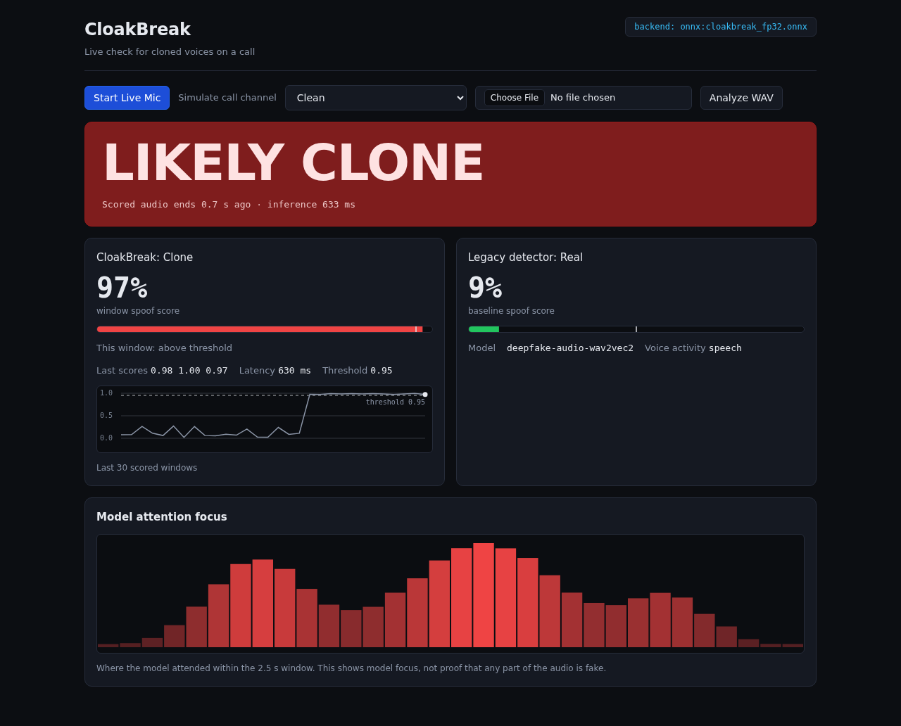

# CloakBreak

Real-time speech deepfake detector trained to survive phone and Opus codecs, built on Vast.ai GPUs.

> Voice clones now get past the ear on calls and voice notes, and the detectors you can download today were mostly trained on clean lab audio. CloakBreak is a WavLM-based detector fine-tuned on modern cloned speech under codec, phone-band and noise augmentation. It is checked against acoustic shortcuts before training and evaluated on a TTS engine it never saw during training.

- **Contest:** Vast.ai Fall 2026 Showcase (`#BuiltOnVast`). Training and evaluation ran on rented Vast GPUs; the demo runs on a 2-vCPU ARM VM.
- **What it does:** scores 2.5 s windows of speech for synthetic-voice evidence, streams decisions over a WebSocket, and shows where the model's attention focused.
- **Evidence:** every number below comes from a logged run. Raw outputs are in [`results/`](results/).

## Why This Matters

- The FBI warned in May 2025 that attackers were sending **AI-generated voice messages impersonating senior US officials** to gain access to accounts ([FBI IC3 PSA I-051525-PSA](https://www.ic3.gov/PSA/2025/PSA250515/)).
- The FCC ruled in February 2024 that **AI-generated voices count as "artificial" voices under the TCPA**, which makes unsolicited AI-voice robocalls illegal without consent ([FCC-24-17](https://www.fcc.gov/document/fcc-confirms-tcpa-applies-ai-technologies-generate-human-voices)).

Real calls are compressed, band-limited and noisy, so a detector has to work after Opus and phone codecs, not only on studio WAVs.

## How It Works

```
 Session 1 (Vast RTX 4090)                Session 2 (Vast RTX 3090)               Demo (Oracle ARM, CPU)
 ─────────────────────────                ─────────────────────────               ──────────────────────
 InTheWild (real + spoof) ─┐              restore dataset (19,288 clips)          mic / file
 LibriSpeech clean (real) ─┼─► loudness   │                                       │
 Chatterbox-Turbo clones ──┤   + 2.5-10 s ▼                                       ▼
   (watermark disabled,    │   normalize  shortcut gate: trivial 4-feature        newest 2.5 s window
    disjoint text)         │              classifier on AUGMENTED windows          (decisions only after >= 2 s)
 Kokoro-82M (held out, ────┘              must score AUROC < 0.60                  │
   test only, disjoint text)              │                                       ▼
                                          ▼                                       fp32 ONNX WavLM detector
                            WavLM-Base-Plus + attentive stats pooling               │
                            stage 1: head (2 epochs) / stage 2: top 6 layers (6)   ▼
                            augmentation: Opus 16k, phone 8k, noise, clipping,     window score vs threshold 0.9526,
                            low-pass / shelf EQ / tilt (class-agnostic)            FAKE if 2 of last 3 windows hit
                                          │
                                          ▼
                            fp32 ONNX export, INT8 parity check (failed -> fp32 ships),
                            eval on 13 slices vs legacy baseline, per-epoch HF checkpoints
```

## Architecture & Capability Mapping

| Component | Where | What it powers |
| :--- | :--- | :--- |
| Vast.ai RTX 4090 | `scripts/session1_vast.sh` | Dataset build: InTheWild + LibriSpeech export, 2,988 Chatterbox-Turbo clones, 600 held-out Kokoro clips |
| Vast.ai RTX 3090 | `scripts/session2_vast.sh` | Shortcut gate, 8-epoch fine-tune, ONNX export, INT8 parity, full evaluation with baseline |
| `microsoft/wavlm-base-plus` | `src/model.py` | Backbone; attentive statistics pooling head exposes per-frame attention |
| Codec / spectral augmentation | `src/augment.py` | Opus 16 kbps (cached), phone 8 kHz, noise, soft clipping, low-pass, shelf EQ, tilt, applied identically to real and fake |
| Shortcut audit | `src/eval.py` | Logistic classifier on duration, RMS, estimated SNR and spectral rolloff, run as a hard gate before training |
| Threshold calibration | `src/calibrate.py` | Picks the operating threshold on the val split only; reports test FPR/TPR without tuning on test |
| Hugging Face Hub (private) | `src/hub.py`, `src/restore_dataset.py` | Synthetic clips, per-epoch checkpoints (preemption-safe resume), ONNX, results, logs |
| FastAPI + WebSocket | `app/main.py`, `src/live.py`, `frontend/index.html` | Live demo: one inference at a time on the newest window, stale windows dropped, 2-of-3 smoothed verdict at the calibrated threshold, raw window score, freshness (lag + inference ms), attention focus |

## Try It in 5 Minutes

The demo UI in a mocked "clone detected" state (desktop):



*Mocked UI states rendered by `scripts/render_screenshots.py` from deterministic payloads — not measurements. Other states: [real voice](docs/screenshots/desktop-real.png), [warming up](docs/screenshots/desktop-warming.png), [mobile real](docs/screenshots/mobile-real.png), [mobile clone](docs/screenshots/mobile-clone.png), [mobile warming](docs/screenshots/mobile-warming.png).*

1. Clone and install the CPU stack (the tests were run with Python 3.11 and `torch 2.15.0+cpu`):
   ```bash
   git clone https://github.com/cipoklean/cloakbreak.git && cd cloakbreak
   python3.11 -m venv .venv
   .venv/bin/pip install torch --index-url https://download.pytorch.org/whl/cpu
   .venv/bin/pip install -r requirements-cpu.txt
   ```
2. Run the test suite (no GPU or downloads needed):
   ```bash
   .venv/bin/python -m pytest -q
   ```
3. Start the demo UI with the built-in mock backend:
   ```bash
   CLOAKBREAK_BACKEND=mock .venv/bin/uvicorn app.main:app --port 8000
   ```
   Open `http://localhost:8000`, allow the microphone, and talk for at least 2 seconds. The UI shows the smoothed FAKE/REAL verdict, the raw score of each window, and how old the scored audio is.
4. With the trained model (weights are in the private repo `Cipoklean/cloakbreak-wavlm`; access required):
   ```bash
   .venv/bin/hf download Cipoklean/cloakbreak-wavlm onnx/cloakbreak_fp32.onnx --local-dir artifacts/session2
   CLOAKBREAK_BACKEND=onnx \
   CLOAKBREAK_MODEL_PATH=artifacts/session2/onnx/cloakbreak_fp32.onnx \
   .venv/bin/uvicorn app.main:app --port 8000
   ```
   `/api/health` reports the threshold in use. `results/threshold_calibration.json` is loaded automatically only when its `model_sha256` matches the model file; otherwise the app falls back to 0.5 and reports it.

## Safety, Privacy & Guardrails

1. Voice cloning was used only to build training data and, for the private demo, only on the author's own voice.
2. The clone endpoint (`POST /api/clone`) is off by default (`ENABLE_CLONE_ENDPOINT=false`), requires a bearer token when enabled, and is never exposed publicly.
3. Chatterbox's Perth watermark was disabled for training data on purpose, so the detector cannot learn to spot the watermark instead of synthesis artifacts.
4. Kokoro-82M was never used in training. Its prompt sentences are disjoint from the training sentences, and a check fails the run if any sentence overlaps.
5. The attention view shows where the model focused. It is not proof that a particular stretch of audio is fake.
6. A verdict is a risk signal, not proof. See Honest Limits before relying on it.

## Engineering Highlights (Verified)

All model numbers are fp32. GPU numbers come from Session 2 (`results/session2/`); calibration numbers come from a CPU re-run on the Oracle ARM VM (`results/threshold_calibration.json`).

**Benchmark (Session 2, torch fp32 on RTX 3090, EER in %, lower is better):**

| Eval slice | Clips (real/spoof) | Baseline EER | CloakBreak EER | CloakBreak AUROC |
| :--- | :---: | :---: | :---: | :---: |
| test_clean | 590 (295/295) | 40.00 | 3.73 | 0.9905 |
| test_opus_16k | 590 (295/295) | 41.36 | 5.76 | 0.9866 |
| test_phone_8k | 590 (295/295) | 46.10 | 9.15 | 0.9603 |
| test_noise_10db | 590 (295/295) | 63.39 | 16.61 | 0.8730 |
| test_noise_5db | 590 (295/295) | 68.14 | 21.02 | 0.8554 |
| clean_real_vs_kokoro_clean (unseen TTS) | 600 (300/300) | 59.00 | 6.33 | 0.9822 |
| clean_real_vs_kokoro_opus_16k (unseen TTS) | 600 (300/300) | 58.17 | 5.67 | 0.9837 |
| unseen_kokoro_opus_16k (wild real vs Kokoro) | 600 (300/300) | 88.00 | 3.33 | 0.9958 |
| rolloff_matched_clean | 590 (295/295) | 31.53 | 6.78 | 0.9790 |
| Floor: trivial 4-feature logistic | 600 | N/A | 36.03 | 0.7084 |

The baseline is [`Vansh180/deepfake-audio-wav2vec2`](https://huggingface.co/Vansh180/deepfake-audio-wav2vec2), run on exactly the same clips.

**Operating threshold (val split only, target 5% FPR on real val clips):**

- Threshold **0.9526**: val FPR 4.93% (750 real clips), val TPR 88.12% (303 spoofs). The val EER threshold is 0.7494 (val EER 8.67%, AUROC 0.9740).
- Test results at 0.9526, never used for selection:

| Test slice | FPR at 0.9526 | TPR at 0.9526 | FPR at 0.5 |
| :--- | :---: | :---: | :---: |
| clean human speech (600 LibriSpeech test clips) | 4.67% | n/a | 18.17% |
| test_clean | 0.00% | 87.80% | 2.03% |
| test_opus_16k | 0.00% | 87.80% | 6.44% |
| unseen_kokoro_clean (wild real vs Kokoro) | 0.33% | 92.67% | 2.33% |
| unseen_kokoro_opus_16k (wild real vs Kokoro) | 0.33% | 93.67% | 7.00% |
| clean_real_vs_kokoro_clean | 5.33% | 92.67% | 19.33% |
| clean_real_vs_kokoro_opus_16k | 5.00% | 93.67% | 17.67% |

**Other measured facts:**

- Shortcut gate: the trivial classifier scored AUROC 0.6459 on unaugmented training windows and 0.5794 on augmented ones (gate threshold 0.60).
- Training: 8 epochs × 682 steps on one RTX 3090, 62–71 s per epoch; best val EER 8.67%.
- GPU latency per 2.5 s window (torch, RTX 3090, test_clean): p50 20.7 ms, p95 23.6 ms.
- CPU reproduction: fp32 ONNX on the 2-vCPU Oracle ARM VM gave the same val AUROC (0.9740) and EER (8.67%) as the Session 2 run, and the same test_clean EER (3.73%).
- ARM CPU latency per 2.5 s window (fp32 ONNX, 2 threads, Oracle Neoverse-N1 with 2 vCPUs, 100 test clips): p50 702.1 ms, p95 1218.8 ms (`results/latency_oracle_arm_fp32.json`).
- Live stream on the same ARM VM (2 min, real time, fp32 ONNX): verdict lag p50 681.3 ms, p95 741.5 ms, max 796.5 ms, with one inference in flight at a time (`results/live_lag_oracle_arm_fp32.json`).
- fp32 ONNX vs torch checkpoint on the 1,053 val clips: identical AUROC (0.9740) and EER (8.67%), max probability difference 0.0001.
- 53 CPU tests pass, with transformers 5.2.0 and NumPy 1.26.4 pinned to match the GPU lockfile.

## Honest Limits

1. **Short clips are at chance.** EER is 52.54% at 0.5 s and 35.59% at 0.8 s. The demo only makes a decision once at least 2 s are buffered, scores the newest 2.5 s window, and rejects uploads shorter than 2 s.
2. **Noise hurts.** EER rises to 16.61% at 10 dB SNR and 21.02% at 5 dB SNR.
3. **INT8 is unusable.** Dynamic INT8 quantization dropped val AUROC from 0.9740 to 0.8680, so only fp32 ships.
4. **At 0.5, the detector flags too many real voices.** 18.17% of clean human test clips score above 0.5. The calibrated threshold (0.9526) brings that down to 4.67%, but it also lets more fakes through: TPR is 87.80% on test_clean.
5. **The "unseen Kokoro" headline needs context.** `unseen_kokoro_*` pairs InTheWild real clips (noisy, in-the-wild) with studio-clean Kokoro output, so channel differences help. The fairer unseen-TTS numbers are `clean_real_vs_kokoro_*` (LibriSpeech vs Kokoro): 6.33% EER clean and 5.67% after Opus.
6. **test_clean is mostly InTheWild.** It is 295 InTheWild real clips against 265 InTheWild spoofs and only 30 Chatterbox clones. Val has 90 Chatterbox clips.
7. **Channel shortcuts are reduced, not gone.** On test model windows, the trivial 4-feature classifier still reaches AUROC 0.7084 (EER 36.03%). The rolloff-matched slice (6.78% EER) shows that the model does not depend only on spectral rolloff.
8. **The baseline is not a strong competitor.** Its config maps `0=real, 1=fake`, and CloakBreak reads the `fake` probability (unit-tested with both label orders). Its model card says it was trained on ASVspoof 2021 PA, a replay-attack set, so it is out of its domain on TTS clones. It flags only 0.17% of clean human clips at 0.5, which shows its labels are not flipped. It is the legacy reference, not a state-of-the-art comparison.
9. **Opus results vary slightly with the ffmpeg/libopus build.** On the ARM VM re-run, test_opus_16k EER was 6.10% (5.76% on the Vast box) and unseen_kokoro_opus_16k was 3.67% (3.33%).
10. **One model, one seed, about 600 clips per slice.** There are no confidence intervals. Each decision looks at a single 2.5 s window (for files, the center 2.5 s).
11. **On the ARM demo VM, verdicts are about 0.7 s behind live audio and arrive about every 0.63 s, not every 0.25 s.** In this run one fp32 window took 632.9 ms at p50 (702.1 ms in the separate 100-clip latency benchmark above). The live scorer runs one inference at a time, always on the newest 2.5 s window, and drops windows that went stale while it was busy. In a 2-minute real-time stream on the 2-vCPU Oracle VM (client and server on the same VM, 185 verdicts, `results/live_lag_oracle_arm_fp32.json`):
    - verdict lag, from sending the window's last audio sample to receiving its verdict: p50 681.3 ms, p95 741.5 ms, max 796.5 ms;
    - the lag did not grow: p95 was 742.2 ms in the first half of the stream and 736.1 ms in the second;
    - 187 windows were dropped as stale.

    The FAKE label also needs 2 of the last 3 scored windows at or above the threshold, so after a switch to fake speech it appears at least one extra verdict later. How long that takes end to end was not measured.

## Repository Structure

```
cloakbreak/
├── app/main.py                 FastAPI app: detect-file, WebSocket stream, private clone endpoint
├── frontend/index.html         Live demo UI
├── docs/screenshots/           Mocked demo-state screenshots (render_screenshots.py)
├── src/
│   ├── audio_utils.py          Loading, loudness normalization, rolling buffer, SNR / rolloff features
│   ├── augment.py              Codec, phone, noise, clipping and spectral augmentation; Opus cache
│   ├── generate_spoofs.py      Session 1 dataset builder (InTheWild, LibriSpeech, Chatterbox, Kokoro)
│   ├── restore_dataset.py      Session 2 restore: HF snapshot + upstream real clips, verified by manifest
│   ├── model.py                WavLM detector, ONNX export, runtimes, legacy baseline wrapper
│   ├── train.py                Two-stage training, resume, budget guard, per-epoch HF checkpoints
│   ├── eval.py                 Eval slices, shortcut audits, rolloff matching, INT8 parity
│   ├── calibrate.py            Val-only threshold calibration
│   ├── live.py                 Live scorer: newest-window inference, stale-window dropping, 2-of-3 smoothing
│   ├── hub.py                  Hugging Face upload/download helpers
│   └── sysinfo.py              cgroup-aware CPU count
├── scripts/
│   ├── session1_vast.sh        Vast Session 1 (dataset build)
│   ├── session2_vast.sh        Vast Session 2 (gate, train, export, eval, upload)
│   ├── smoke_e2e.sh            GPU end-to-end smoke pipeline
│   ├── preflight_vast.py       Import sweep, hidden-backend checks, GPU check
│   ├── bench_latency.py        CPU latency benchmark for the ONNX model
│   ├── bench_live_lag.py       End-to-end live verdict-lag benchmark (uvicorn + WebSocket client)
│   ├── render_screenshots.py   Playwright screenshots of mocked demo states (not measurements)
│   └── hf_auth_check.py        HF token role / namespace check
├── results/
│   ├── threshold_calibration.json   Val-selected threshold + test FPR/TPR (CPU re-run)
│   ├── calibration_cache/      Per-clip fp32 scores behind the calibration (val + test slices)
│   ├── latency_oracle_arm_fp32.json
│   ├── live_lag_oracle_arm_fp32.json
│   └── session2/               Session 2 eval JSON, results table, audits, parity, key lines
├── tests/                      CPU test suite
├── pyproject.toml             pytest config (pythonpath, testpaths)
├── requirements-cpu.txt / requirements-gpu.txt / requirements-gpu.lock
└── SUBMISSION_LOG.md           Vast session ledger
```

## Local Development & Verification

```bash
# CPU tests (pinned env: numpy 1.26.4, pyarrow 25.0.0, pandas 3.0.6, datasets 5.2.0, transformers 5.2.0)
.venv/bin/python -m pytest -v
bash -n scripts/*.sh

# Restore the val/test clips (needs read access to the private dataset repo)
.venv/bin/python -m src.restore_dataset --repo Cipoklean/cloakbreak-data-v1 --out-dir data/cloakbreak_v1 --splits val,test

# Re-run threshold calibration on CPU (val selects, test reports)
.venv/bin/python -m src.calibrate --manifest data/cloakbreak_v1/manifest.jsonl \
  --backend onnx --model-path artifacts/session2/onnx/cloakbreak_fp32.onnx \
  --target-fpr 0.05 --max-per-slice 600 --out results/threshold_calibration.json

# Vast sessions (run inside the tmux session Vast opens on SSH login)
SMOKE=1 bash scripts/session2_vast.sh   # capped end-to-end check
bash scripts/session2_vast.sh           # full run; rerun the same command to resume
```

## Disclaimer / Attribution

CloakBreak is a research demo, not a forensic tool. Data and models used:

- [`SpeechAntiSpoofingBenchmarks/InTheWild`](https://huggingface.co/datasets/SpeechAntiSpoofingBenchmarks/InTheWild) (Apache-2.0)
- [`openslr/librispeech_asr`](https://huggingface.co/datasets/openslr/librispeech_asr) (CC-BY-4.0)
- [`agentlans/high-quality-english-sentences`](https://huggingface.co/datasets/agentlans/high-quality-english-sentences) (ODC-BY)
- [`ResembleAI/chatterbox`](https://huggingface.co/ResembleAI/chatterbox) (MIT)
- [`hexgrad/Kokoro-82M`](https://huggingface.co/hexgrad/Kokoro-82M) (Apache-2.0)
- [`microsoft/wavlm-base-plus`](https://huggingface.co/microsoft/wavlm-base-plus)
- [`Vansh180/deepfake-audio-wav2vec2`](https://huggingface.co/Vansh180/deepfake-audio-wav2vec2) (MIT)

The non-commercial fallbacks `SWivid/F5-TTS` and `facebook/mms-tts-eng` (CC-BY-NC-4.0) were not used.
