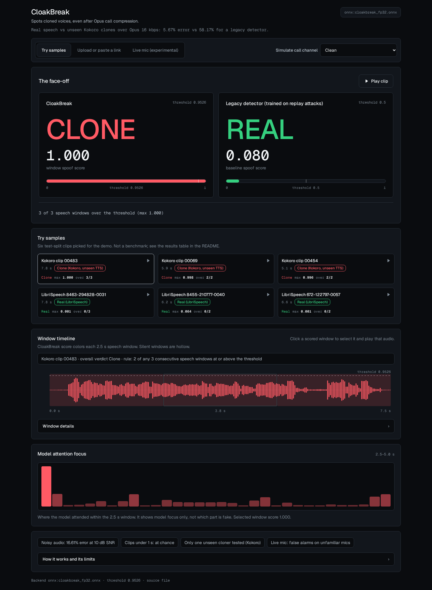

# CloakBreak

Real-time speech deepfake detector trained to survive phone and Opus codecs, built on Vast.ai GPUs.

> Voice clones now get past the ear on calls and voice notes, and the detectors you can download today were mostly trained on clean lab audio. CloakBreak is a WavLM-based detector fine-tuned on modern cloned speech under codec, phone-band and noise augmentation. It is checked against acoustic shortcuts before training and evaluated on a TTS engine it never saw during training.

- **Contest:** Vast.ai Fall 2026 Showcase (`#BuiltOnVast`). Training and evaluation ran on rented Vast GPUs; the demo runs on a 2-vCPU ARM VM.
- **What it does:** scores 2.5 s windows of speech for synthetic-voice evidence, streams decisions over a WebSocket, and shows where the model's attention focused.
- **Evidence:** every number below comes from a logged run. Raw outputs are in [`results/`](results/).

## Why This Matters

- The FBI warned in May 2025 that attackers were sending **AI-generated voice messages impersonating senior US officials** to gain access to accounts ([FBI IC3 PSA I-051525-PSA](https://www.ic3.gov/PSA/2025/PSA250515/)).
- The FCC ruled in February 2024 that **AI-generated voices count as "artificial" voices under the TCPA**, which makes unsolicited AI-voice robocalls illegal without consent ([FCC-24-17](https://www.fcc.gov/document/fcc-confirms-tcpa-applies-ai-technologies-generate-human-voices)).

Real calls are compressed, band-limited and noisy, so a detector has to work after Opus and phone codecs, not only on studio WAVs.

## How It Works

```
 Session 1 (Vast RTX 4090)                Session 2 (Vast RTX 3090)               Demo (Oracle ARM, CPU)
 ─────────────────────────                ─────────────────────────               ──────────────────────
 InTheWild (real + spoof) ─┐              restore dataset (19,288 clips)          mic / file / link
 LibriSpeech clean (real) ─┼─► loudness   │                                       │
 Chatterbox-Turbo clones ──┤   + 2.5-10 s ▼                                       ▼
   (watermark disabled,    │   normalize  shortcut gate: trivial 4-feature        newest live / upload windows
    disjoint text)         │              classifier on AUGMENTED windows          (live decisions only after >= 2 s)
 Kokoro-82M (held out, ────┘              must score AUROC < 0.60                  │
   test only, disjoint text)              │                                       ▼
                                          ▼                                       fp32 ONNX WavLM detector
                            WavLM-Base-Plus + attentive stats pooling               │
                            stage 1: head (2 epochs) / stage 2: top 6 layers (6)   ▼
                            augmentation: Opus 16k, phone 8k, noise, clipping,     window score vs threshold 0.9526,
                            low-pass / shelf EQ / tilt (class-agnostic)            FAKE if 2 of last 3 windows hit
                                          │
                                          ▼
                            fp32 ONNX export, INT8 parity check (failed -> fp32 ships),
                            eval on 13 slices vs legacy baseline, per-epoch HF checkpoints
```

## Architecture & Capability Mapping

| Component | Where | What it powers |
| :--- | :--- | :--- |
| Vast.ai RTX 4090 | `scripts/session1_vast.sh` | Dataset build: InTheWild + LibriSpeech export, 2,988 Chatterbox-Turbo clones, 600 held-out Kokoro clips |
| Vast.ai RTX 3090 | `scripts/session2_vast.sh` | Shortcut gate, 8-epoch fine-tune, ONNX export, INT8 parity, full evaluation with baseline |
| `microsoft/wavlm-base-plus` | `src/model.py` | Backbone; attentive statistics pooling head exposes per-frame attention |
| Codec / spectral augmentation | `src/augment.py` | Opus 16 kbps (cached), phone 8 kHz, noise, soft clipping, low-pass, shelf EQ, tilt, applied identically to real and fake |
| Shortcut audit | `src/eval.py` | Logistic classifier on duration, RMS, estimated SNR and spectral rolloff, run as a hard gate before training |
| Threshold calibration | `src/calibrate.py` | Picks the operating threshold on the val split only; reports test FPR/TPR without tuning on test |
| Hugging Face Hub (private) | `src/hub.py`, `src/restore_dataset.py` | Synthetic clips, per-epoch checkpoints (preemption-safe resume), ONNX, results, logs |
| React + TypeScript UI | `web/src/` | Three-tab demo (Try samples, Upload or paste a link, Live mic), per-window timeline, attention view, honest-limit numbers fetched from `/api/facts` |
| FastAPI job queue + WebSocket | `app/main.py`, `src/jobs.py`, `src/live.py` | One file/sample/link analysis at a time in FIFO order; live mic uses one inference at a time on the newest window, drops stale windows, and smooths the verdict with the calibrated threshold |

## Try It in 5 Minutes

The running app after analyzing the six Try samples clips (fp32 ONNX on the Oracle ARM VM, Clean channel, legacy detector loaded):



*Real screenshot with real scores from the new all-window analysis UI, rendered by `scripts/render_screenshots.py`; the displayed values are saved in [`results/try_samples_real.json`](results/try_samples_real.json). The six clips are test-split files picked for the demo, not a benchmark. More real captures: [Kokoro mobile](docs/screenshots/real-samples-kokoro-mobile.png), [LibriSpeech desktop](docs/screenshots/real-samples-librispeech-desktop.png), [LibriSpeech mobile](docs/screenshots/real-samples-librispeech-mobile.png), [upload desktop](docs/screenshots/real-upload-desktop.png), [upload mobile](docs/screenshots/real-upload-mobile.png), [busy-queue desktop](docs/screenshots/real-busy-desktop.png), [busy-queue mobile](docs/screenshots/real-busy-mobile.png).*

Per-window analysis at threshold 0.9526 (`CloakBreak / legacy` for each scored 2.5 s window; the legacy cutoff is 0.5):

| Try samples clip | Ground truth | Overall verdict | Max window score | Windows over threshold | Window scores |
| :--- | :--- | :---: | :---: | :---: | :--- |
| kokoro_00483 | Clone (Kokoro, unseen TTS) | Clone | 1.000 | 3/3 | 1.000/0.071 · 1.000/0.080 · 0.995/0.065 |
| kokoro_00069 | Clone (Kokoro, unseen TTS) | Clone | 0.998 | 2/2 | 0.998/0.074 · 0.991/0.072 |
| kokoro_00454 | Clone (Kokoro, unseen TTS) | Clone | 0.996 | 2/2 | 0.996/0.068 · 0.977/0.070 |
| LibriSpeech 8463-294828-0031 | Real | Real | 0.001 | 0/3 | 0.001/0.070 · 0.000/0.078 · 0.000/0.072 |
| LibriSpeech 8455-210777-0040 | Real | Real | 0.064 | 0/2 | 0.000/0.123 · 0.064/0.086 |
| LibriSpeech 672-122797-0057 | Real | Real | 0.001 | 0/2 | 0.001/0.277 · 0.000/0.097 |

These are six hand-picked clips for the demo, not a benchmark; use the evaluation tables below for measured performance.

1. Clone and install the CPU stack (the tests were run with Python 3.11 and `torch 2.15.0+cpu`):
   ```bash
   git clone https://github.com/cipoklean/cloakbreak.git && cd cloakbreak
   python3.11 -m venv .venv
   .venv/bin/pip install torch --index-url https://download.pytorch.org/whl/cpu
   .venv/bin/pip install -r requirements-cpu.txt
   ```
   `requirements-cpu.txt` includes `yt-dlp` for link analysis. Install `ffmpeg` too — on Debian/Ubuntu: `sudo apt install ffmpeg` — because uploads and downloaded links are decoded through it.
2. Build the React UI (Node 20+; this checkout was built with Node 24):
   ```bash
   cd web
   npm ci
   npm run build
   cd ..
   ```
   This writes `web/dist/` (gitignored). You do not need a separate frontend server for normal use.
3. Run the test suite (no GPU or downloads needed):
   ```bash
   .venv/bin/python -m pytest -q
   ```
4. Start the demo UI with the built-in mock backend:
   ```bash
   CLOAKBREAK_BACKEND=mock .venv/bin/uvicorn app.main:app --port 8000
   ```
   Open `http://localhost:8000` — one uvicorn process serves both the API and the built React UI at the same URL. The page has three tabs: **Try samples** (default), **Upload or paste a link** and **Live mic (experimental)**. In the Live mic tab, allow the microphone and talk for at least 2 seconds; the UI shows the smoothed verdict, the raw score of each window, how old the scored audio is, and your input level against the speech gate.
5. With the trained model (weights are in the private repo `Cipoklean/cloakbreak-wavlm`; access required):
   ```bash
   .venv/bin/hf download Cipoklean/cloakbreak-wavlm onnx/cloakbreak_fp32.onnx --local-dir artifacts/session2
   CLOAKBREAK_BACKEND=onnx \
   CLOAKBREAK_MODEL_PATH=artifacts/session2/onnx/cloakbreak_fp32.onnx \
   CLOAKBREAK_BASELINE_ID=Vansh180/deepfake-audio-wav2vec2 \
   .venv/bin/uvicorn app.main:app --port 8000
   ```
   Omit `CLOAKBREAK_BASELINE_ID` if you do not want the legacy detector. The Try samples tab reads its six clips from `data/cloakbreak_v1/` (restore it first, see [Local Development](#local-development--verification)); clips that are missing show as "not restored". `/api/health` reports the threshold in use. `results/threshold_calibration.json` is loaded automatically only when its `model_sha256` matches the model file; otherwise the app falls back to 0.5 and reports it.

   For frontend development instead of a production build, keep uvicorn on port 8765 and run Vite separately:
   ```bash
   CLOAKBREAK_BACKEND=mock .venv/bin/uvicorn app.main:app --port 8765
   cd web && npm run dev
   ```
   Vite serves the UI on its own local URL and proxies `/api` plus `/ws` to `http://localhost:8765` (`CLOAKBREAK_PROXY_TARGET` overrides that target).

## Public demo with a Cloudflare quick tunnel

A Cloudflare quick tunnel gives a temporary public `https://*.trycloudflare.com` URL with no account or signup. Start the app on port 8765 in one terminal:

```bash
CLOAKBREAK_BACKEND=onnx \
CLOAKBREAK_MODEL_PATH=artifacts/session2/onnx/cloakbreak_fp32.onnx \
.venv/bin/uvicorn app.main:app --host 127.0.0.1 --port 8765
```

In a second terminal, start the tunnel:

```bash
bash scripts/public_tunnel.sh
```

Share the `trycloudflare.com` URL printed by cloudflared. The script checks `/api/health`, refuses to run if `ENABLE_CLONE_ENDPOINT=true` is set in the shell, and execs `cloudflared tunnel --url http://localhost:8765`. Set `CLOAKBREAK_PORT` to use another local port. Anyone with the URL can use the demo: live-mic audio is sent to your machine for scoring, analyses share one FIFO worker, and only one browser can use the live mic at a time. Stop the tunnel with Ctrl+C when the demo is over. The clone endpoint must stay off for a public tunnel.

## Safety, Privacy & Guardrails

1. Voice cloning was used only to build training data and, for the private demo, only on the author's own voice.
2. The clone endpoint (`POST /api/clone`) is off by default (`ENABLE_CLONE_ENDPOINT=false`), requires a bearer token when enabled, and is never exposed publicly.
3. Chatterbox's Perth watermark was disabled for training data on purpose, so the detector cannot learn to spot the watermark instead of synthesis artifacts.
4. Kokoro-82M was never used in training. Its prompt sentences are disjoint from the training sentences, and a check fails the run if any sentence overlaps.
5. The attention view shows where the model focused. It is not proof that a particular stretch of audio is fake.
6. A verdict is a risk signal, not proof. See Honest Limits before relying on it.
7. Try samples serves six allowlisted clip IDs only (`GET /api/samples`, `POST /api/samples/{id}/detect`, `GET /api/samples/{id}/audio`); the server never accepts a file path from the client. The clip audio is not in the repository.
8. File, sample and link analyses share one FIFO worker: only one analysis job is scored at a time, queued clients are shown their position, at most 10 unfinished jobs are accepted (the 11th gets HTTP 429), and finished results expire after 10 minutes.
9. Only one browser can use the live mic at a time. A second websocket gets the explicit busy message "Someone else is using the mic. Try again in a moment."
10. Link analysis validates the pasted URL before queueing it: only http/https with a real hostname and no userinfo, and every resolved IP must be public unicast; private, loopback, link-local, cloud-metadata, multicast, reserved and unspecified addresses are refused. It does not revalidate redirect targets after yt-dlp starts downloading, so redirect-based SSRF is a known residual risk. Do not expose link analysis from a machine where lateral network access matters.
11. Uploads are limited to 50 MB and analysis covers at most the first 60 seconds; ffmpeg decode failures return a user-facing error rather than a server traceback.
12. Live-mic audio is streamed to the server for scoring and is not stored by default. Debug capture (`CLOAKBREAK_DEBUG_CAPTURE=1`) is off by default and, when enabled, writes to `results/live_capture/`, which is gitignored.

## Engineering Highlights (Verified)

All model numbers are fp32. GPU numbers come from Session 2 (`results/session2/`); calibration numbers come from a CPU re-run on the Oracle ARM VM (`results/threshold_calibration.json`).

**Benchmark (Session 2, torch fp32 on RTX 3090, EER in %, lower is better):**

| Eval slice | Clips (real/spoof) | Baseline EER | CloakBreak EER | CloakBreak AUROC |
| :--- | :---: | :---: | :---: | :---: |
| test_clean | 590 (295/295) | 40.00 | 3.73 | 0.9905 |
| test_opus_16k | 590 (295/295) | 41.36 | 5.76 | 0.9866 |
| test_phone_8k | 590 (295/295) | 46.10 | 9.15 | 0.9603 |
| test_noise_10db | 590 (295/295) | 63.39 | 16.61 | 0.8730 |
| test_noise_5db | 590 (295/295) | 68.14 | 21.02 | 0.8554 |
| clean_real_vs_kokoro_clean (unseen TTS) | 600 (300/300) | 59.00 | 6.33 | 0.9822 |
| clean_real_vs_kokoro_opus_16k (unseen TTS) | 600 (300/300) | 58.17 | 5.67 | 0.9837 |
| unseen_kokoro_opus_16k (wild real vs Kokoro) | 600 (300/300) | 88.00 | 3.33 | 0.9958 |
| rolloff_matched_clean | 590 (295/295) | 31.53 | 6.78 | 0.9790 |
| Floor: trivial 4-feature logistic | 600 | N/A | 36.03 | 0.7084 |

The baseline is [`Vansh180/deepfake-audio-wav2vec2`](https://huggingface.co/Vansh180/deepfake-audio-wav2vec2), run on exactly the same clips.

**Operating threshold (val split only, target 5% FPR on real val clips):**

- Threshold **0.9526**: val FPR 4.93% (750 real clips), val TPR 88.12% (303 spoofs). The val EER threshold is 0.7494 (val EER 8.67%, AUROC 0.9740).
- Test results at 0.9526, never used for selection:

| Test slice | FPR at 0.9526 | TPR at 0.9526 | FPR at 0.5 |
| :--- | :---: | :---: | :---: |
| clean human speech (600 LibriSpeech test clips) | 4.67% | n/a | 18.17% |
| test_clean | 0.00% | 87.80% | 2.03% |
| test_opus_16k | 0.00% | 87.80% | 6.44% |
| unseen_kokoro_clean (wild real vs Kokoro) | 0.33% | 92.67% | 2.33% |
| unseen_kokoro_opus_16k (wild real vs Kokoro) | 0.33% | 93.67% | 7.00% |
| clean_real_vs_kokoro_clean | 5.33% | 92.67% | 19.33% |
| clean_real_vs_kokoro_opus_16k | 5.00% | 93.67% | 17.67% |

**Other measured facts:**

- Shortcut gate: the trivial classifier scored AUROC 0.6459 on unaugmented training windows and 0.5794 on augmented ones (gate threshold 0.60).
- Training: 8 epochs × 682 steps on one RTX 3090, 62–71 s per epoch; best val EER 8.67%.
- GPU latency per 2.5 s window (torch, RTX 3090, test_clean): p50 20.7 ms, p95 23.6 ms.
- CPU reproduction: fp32 ONNX on the 2-vCPU Oracle ARM VM gave the same val AUROC (0.9740) and EER (8.67%) as the Session 2 run, and the same test_clean EER (3.73%).
- ARM CPU latency per 2.5 s window (fp32 ONNX, 2 threads, Oracle Neoverse-N1 with 2 vCPUs, 100 test clips): p50 702.1 ms, p95 1218.8 ms (`results/latency_oracle_arm_fp32.json`).
- Browser fallback resampler (48 kHz sweep, compared with `scipy` `resample_poly`): aliasing from 8.5–20 kHz is −96.3 dB vs 0.0 dB for the old every-third-sample decimation, and the speech spectrum matches within 0.11 dB on average from 100 Hz to 7 kHz (`tests/test_resampler_js.py`).
- Live stream on the same ARM VM (2 min, real time, fp32 ONNX): verdict lag p50 681.3 ms, p95 741.5 ms, max 796.5 ms, with one inference in flight at a time (`results/live_lag_oracle_arm_fp32.json`).
- fp32 ONNX vs torch checkpoint on the 1,053 val clips: identical AUROC (0.9740) and EER (8.67%), max probability difference 0.0001.
- Try samples in the running app (fp32 ONNX on the ARM VM): the three Kokoro clips had max window scores 0.996–1.000 (overall Clone) while their legacy windows scored 0.065–0.080 (Real); the three LibriSpeech clips had max window scores 0.001–0.064 (overall Real). Six hand-picked clips, not a benchmark (`results/try_samples_real.json`).
- Builder's headset capture (29.8 s, real voice): 12 of 55 windows at or above the threshold (21.8%), see Honest Limits #12 (`results/live_mic_headset_ab17x_grid.json`).
- 106 CPU tests pass, with transformers 5.2.0 and NumPy 1.26.4 pinned to match the GPU lockfile.

## Honest Limits

1. **Short clips are at chance.** EER is 52.54% at 0.5 s and 35.59% at 0.8 s. The demo only makes a decision once at least 2 s are buffered, scores the newest 2.5 s window, and rejects uploads shorter than 2 s.
2. **Noise hurts.** EER rises to 16.61% at 10 dB SNR and 21.02% at 5 dB SNR.
3. **INT8 is unusable.** Dynamic INT8 quantization dropped val AUROC from 0.9740 to 0.8680, so only fp32 ships.
4. **At 0.5, the detector flags too many real voices.** 18.17% of clean human test clips score above 0.5. The calibrated threshold (0.9526) brings that down to 4.67%, but it also lets more fakes through: TPR is 87.80% on test_clean.
5. **Only one unseen cloner was tested, and the `unseen_kokoro_*` slices need context.** Kokoro is the only unseen TTS engine in the evaluation. `unseen_kokoro_*` pairs InTheWild real clips (noisy, in-the-wild) with studio-clean Kokoro output, so channel differences help. The fairer unseen-TTS numbers are `clean_real_vs_kokoro_*` (LibriSpeech vs Kokoro): 6.33% EER clean and 5.67% after Opus.
6. **test_clean is mostly InTheWild.** It is 295 InTheWild real clips against 265 InTheWild spoofs and only 30 Chatterbox clones. Val has 90 Chatterbox clips.
7. **Channel shortcuts are reduced, not gone.** On test model windows, the trivial 4-feature classifier still reaches AUROC 0.7084 (EER 36.03%). The rolloff-matched slice (6.78% EER) shows that the model does not depend only on spectral rolloff.
8. **The baseline is not a strong competitor.** Its config maps `0=real, 1=fake`, and CloakBreak reads the `fake` probability (unit-tested with both label orders). Its model card says it was trained on ASVspoof 2021 PA, a replay-attack set, so it is out of its domain on TTS clones. It flags only 0.17% of clean human clips at 0.5, which shows its labels are not flipped. It is the legacy reference, not a state-of-the-art comparison.
9. **Opus results vary slightly with the ffmpeg/libopus build.** On the ARM VM re-run, test_opus_16k EER was 6.10% (5.76% on the Vast box) and unseen_kokoro_opus_16k was 3.67% (3.33%).
10. **One model, one seed, about 600 clips per slice.** There are no confidence intervals. Each live decision looks at a single newest 2.5 s window; file, sample and link analyses score non-overlapping 2.5 s speech windows and apply the same 2-of-3 consecutive-window rule.
11. **On the ARM demo VM, verdicts are about 0.7 s behind live audio and arrive about every 0.63 s, not every 0.25 s.** In this run one fp32 window took 632.9 ms at p50 (702.1 ms in the separate 100-clip latency benchmark above). The live scorer runs one inference at a time, always on the newest 2.5 s window, and drops windows that went stale while it was busy. In a 2-minute real-time stream on the 2-vCPU Oracle VM (client and server on the same VM, 185 verdicts, `results/live_lag_oracle_arm_fp32.json`):
    - verdict lag, from sending the window's last audio sample to receiving its verdict: p50 681.3 ms, p95 741.5 ms, max 796.5 ms;
    - the lag did not grow: p95 was 742.2 ms in the first half of the stream and 736.1 ms in the second;
    - 187 windows were dropped as stale.

    The FAKE label also needs 2 of the last 3 scored windows at or above the threshold, so after a switch to fake speech it appears at least one extra verdict later. How long that takes end to end was not measured.
12. **Live mic false-alarms on the builder's own headset: 21.8% of all windows (26.7% of gate-passed windows).** No retraining was done for this; the model and the 0.9526 threshold are unchanged.
    - **How it was measured:** a 29.8 s capture of the author's real voice (AB17X USB headset, Brave, voice processing off, `CLOAKBREAK_DEBUG_CAPTURE=1`). The capture was re-scored offline with the app's own scoring path (fp32 ONNX, Clean channel) on every 2.5 s window at a 0.5 s hop, ignoring the speech gate (`scripts/rescore_capture_grid.py`; per-window scores and levels in `results/live_mic_headset_ab17x_grid.json`; the audio itself is not committed).
    - **Result:** 12 of 55 windows (21.8%) scored at or above 0.9526; median score 0.246. The new speech gate passes 45 of the 55 windows, and all 12 false alarms are among them (26.7% of gated windows). The legacy detector crossed 0.5 on 3 of 55 windows, all of them silent windows the gate skips.
    - **Why the live app showed nothing during that test:** the headset delivered speech at about −39 to −45 dBFS per window with auto gain off, below the old fixed speech gate (RMS 0.012, about −38.4 dBFS), so all 55 windows were rejected as silence. The gate now tracks the noise floor (10th percentile of 0.25 s block levels over the last 10 s) and opens 6 dB above it, never below −60 dBFS; with too little history it uses −50 dBFS. A fixed −50 dBFS gate was rejected because this headset's silent windows sit at −49 to −52 dBFS. The gate only decides which windows get scored: the scored audio is loudness-normalized to about −23 dBFS RMS before the model sees it, as in training, so input level by itself does not change the score.
    - **Not tested as a cause:** speech windows were only about 10–15 dB above the headset's noise floor, close to the 10 dB SNR condition where EER is 16.61%, and the headset's frequency response is not in the training data. Either could explain the false alarms; neither was isolated.
    - **Browser-path fixes from the earlier laptop-mic test still apply:** the page asks for a 16 kHz `AudioContext` (band-limited resampling, with a 7.2 kHz windowed-sinc FIR fallback) and requests echo cancellation, noise suppression and auto gain off, showing the applied settings in the footer. In headless Chrome with real LibriSpeech speech and −35 dBFS out-of-band noise, 4 of 96 windows (4.17%) crossed the threshold vs 3 of 96 on the original audio (`results/live_mic_fakemic_clean_hf35.json`); on 120 clips with −45 dBFS out-of-band noise, the old decimation flagged 8.33% vs 4.17% after the fix (`results/sim_alias_fpr.json`).

    The page labels Live mic as experimental and shows this result under the verdict. Even on audio like the training data, about 5% of real windows cross the threshold by design (val FPR 4.93%).

## Repository Structure

```
cloakbreak/
├── app/main.py                 FastAPI app: analysis jobs, allowlisted samples, analyze-url, WebSocket stream, private clone endpoint (off)
├── web/
│   ├── src/App.tsx             React app shell: tabs, shared channel selector, verdict state, polling
│   ├── src/components/         Samples, upload/link, live mic, verdict, detector cards, timeline, attention, honest limits
│   ├── src/audio/streamResampler16k.js   Windowed-sinc anti-alias fallback for non-16 kHz AudioContexts
│   ├── package.json / package-lock.json  React 19 + Vite + TypeScript + Tailwind v4 dependencies
│   └── vite.config.ts          Production build and dev proxy for /api + /ws
├── docs/screenshots/           Eight real-* app screenshots with real scores (desktop + mobile)
├── src/
│   ├── analysis.py             All-window clip analysis: speech-gated non-overlapping windows, 2-of-3 verdict
│   ├── jobs.py                 FIFO single-worker job queue, ffmpeg decode, yt-dlp download, SSRF guard
│   ├── audio_utils.py          Loading, loudness normalization, rolling buffer, noise-floor speech gate, SNR / rolloff features
│   ├── augment.py              Codec, phone, noise, clipping and spectral augmentation; Opus cache
│   ├── generate_spoofs.py      Session 1 dataset builder (InTheWild, LibriSpeech, Chatterbox, Kokoro)
│   ├── restore_dataset.py      Session 2 restore: HF snapshot + upstream real clips, verified by manifest
│   ├── model.py                WavLM detector, ONNX export, runtimes, legacy baseline wrapper
│   ├── train.py                Two-stage training, resume, budget guard, per-epoch HF checkpoints
│   ├── eval.py                 Eval slices, shortcut audits, rolloff matching, INT8 parity
│   ├── calibrate.py            Val-only threshold calibration
│   ├── live.py                 Live scorer: newest-window inference, stale-window dropping, 2-of-3 smoothing
│   ├── hub.py                  Hugging Face upload/download helpers
│   └── sysinfo.py              cgroup-aware CPU count
├── scripts/
│   ├── session1_vast.sh        Vast Session 1 (dataset build)
│   ├── session2_vast.sh        Vast Session 2 (gate, train, export, eval, upload)
│   ├── smoke_e2e.sh            GPU end-to-end smoke pipeline
│   ├── preflight_vast.py       Import sweep, hidden-backend checks, GPU check
│   ├── bench_latency.py        CPU latency benchmark for the ONNX model
│   ├── bench_live_lag.py       End-to-end live verdict-lag benchmark (uvicorn + WebSocket client)
│   ├── bench_live_mic.py       Headless-Chrome fake-mic run of the real browser audio path
│   ├── replay_capture.py       Re-score a debug capture offline, window by window
│   ├── rescore_capture_grid.py Re-score a capture on a fixed window grid and replay it through the speech gate
│   ├── sim_alias_fpr.py        Old vs fixed 48 kHz -> 16 kHz path on real clips
│   ├── render_screenshots.py   Real-backend Playwright screenshots + try_samples_real.json regeneration
│   ├── public_tunnel.sh        Cloudflare quick-tunnel helper for a temporary public demo
│   └── hf_auth_check.py        HF token role / namespace check
├── results/
│   ├── threshold_calibration.json   Val-selected threshold + test FPR/TPR (CPU re-run)
│   ├── calibration_cache/      Per-clip fp32 scores behind the calibration (val + test slices)
│   ├── latency_oracle_arm_fp32.json
│   ├── live_lag_oracle_arm_fp32.json
│   ├── live_mic_fakemic_clean_hf35.json
│   ├── live_mic_headset_ab17x_grid.json   Builder's headset capture, re-scored per window
│   ├── try_samples_real.json    Per-window scores the React app displayed for the six Try samples clips
│   ├── sim_alias_fpr.json
│   └── session2/               Session 2 eval JSON, results table, audits, parity, key lines
├── tests/                      CPU test suite
├── pyproject.toml              pytest config (pythonpath, testpaths)
├── requirements-cpu.txt / requirements-gpu.txt / requirements-gpu.lock
└── SUBMISSION_LOG.md           Vast session ledger
```

## Local Development & Verification

```bash
# React UI lint + production build (writes the gitignored web/dist/)
cd web && npm ci && npm run lint && npm run build && cd ..

# CPU tests (pinned env: numpy 1.26.4, pyarrow 25.0.0, pandas 3.0.6, datasets 5.2.0, transformers 5.2.0)
.venv/bin/python -m pytest -v
bash -n scripts/*.sh

# Restore the val/test clips (needs read access to the private dataset repo)
.venv/bin/python -m src.restore_dataset --repo Cipoklean/cloakbreak-data-v1 --out-dir data/cloakbreak_v1 --splits val,test

# Re-run threshold calibration on CPU (val selects, test reports)
.venv/bin/python -m src.calibrate --manifest data/cloakbreak_v1/manifest.jsonl \
  --backend onnx --model-path artifacts/session2/onnx/cloakbreak_fp32.onnx \
  --target-fpr 0.05 --max-per-slice 600 --out results/threshold_calibration.json

# Debug a live-mic false alarm: save exactly what the server received, then re-score it offline
CLOAKBREAK_DEBUG_CAPTURE=1 CLOAKBREAK_BACKEND=onnx \
CLOAKBREAK_MODEL_PATH=artifacts/session2/onnx/cloakbreak_fp32.onnx \
.venv/bin/uvicorn app.main:app --port 8000      # captures land in results/live_capture/ (gitignored)
.venv/bin/python -m scripts.replay_capture --wav results/live_capture/<file>.wav \
  --json results/live_capture/<file>.json --model-path artifacts/session2/onnx/cloakbreak_fp32.onnx
# ...or score every window on a fixed grid (even ones the gate skipped) and see what the gate would pass
.venv/bin/python -m scripts.rescore_capture_grid --wav results/live_capture/<file>.wav \
  --baseline-id Vansh180/deepfake-audio-wav2vec2 --out results/<name>.json

# Screenshots + results/try_samples_real.json (Playwright via uv, not a project dependency; real backend only)
uv run --with playwright==1.65.2 python scripts/render_screenshots.py

# Vast sessions (run inside the tmux session Vast opens on SSH login)
SMOKE=1 bash scripts/session2_vast.sh   # capped end-to-end check
bash scripts/session2_vast.sh           # full run; rerun the same command to resume
```

## Disclaimer / Attribution

CloakBreak is a research demo, not a forensic tool. Data and models used:

- [`SpeechAntiSpoofingBenchmarks/InTheWild`](https://huggingface.co/datasets/SpeechAntiSpoofingBenchmarks/InTheWild) (Apache-2.0)
- [`openslr/librispeech_asr`](https://huggingface.co/datasets/openslr/librispeech_asr) (CC-BY-4.0)
- [`agentlans/high-quality-english-sentences`](https://huggingface.co/datasets/agentlans/high-quality-english-sentences) (ODC-BY)
- [`ResembleAI/chatterbox`](https://huggingface.co/ResembleAI/chatterbox) (MIT)
- [`hexgrad/Kokoro-82M`](https://huggingface.co/hexgrad/Kokoro-82M) (Apache-2.0)
- [`microsoft/wavlm-base-plus`](https://huggingface.co/microsoft/wavlm-base-plus)
- [`Vansh180/deepfake-audio-wav2vec2`](https://huggingface.co/Vansh180/deepfake-audio-wav2vec2) (MIT)

The non-commercial fallbacks `SWivid/F5-TTS` and `facebook/mms-tts-eng` (CC-BY-NC-4.0) were not used.
